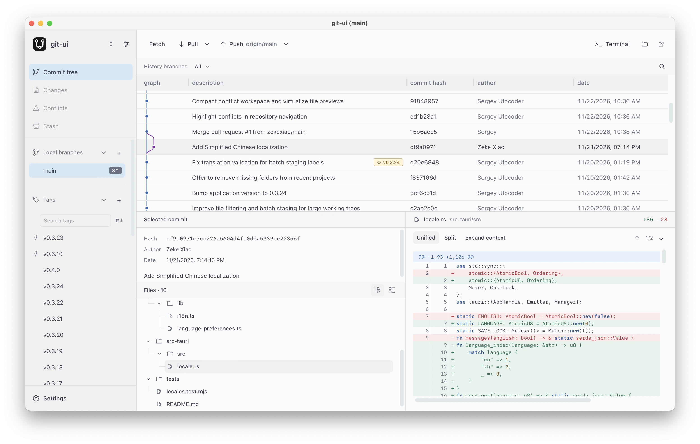

# GIT UI

GIT UI is a free desktop Git client for macOS and Windows. Browse commit history,
review changes, and work with branches, tags, and stashes in one window.

Available in **English, Russian, and Simplified Chinese**.

**[Download from GitHub Releases](https://github.com/ufocoder/git-ui/releases/latest)** ·
[Website](https://ufocoder.github.io/git-ui/) ·
[User guide](docs/features.md)

## Built for everyday Git work

I built GIT UI for my own work a  nd use it on my own repositories. It will always
be free to use. You can read the source in this repository, inspect the release
workflow, or build the app yourself.

- **Use your existing repositories.** Open a local folder and work with the Git
  installation, remotes, and authentication you already use. No GIT UI account
  is required.
- **Review before you commit.** Browse the commit graph, compare changes in
  unified or split view, and stage individual files or hunks.
- **See what Git did.** The built-in terminal log shows the output of Git
  operations, including errors.

## Features

- Browse and search commit history across local and remote branches.
- Review unified or split diffs; stage files, folders, or individual hunks.
- Create, amend, and sign commits using your configured GPG or SSH key.
- Manage and pin branches and tags; fetch, pull, push, and rebase branches.
- Resolve conflicts with side-by-side versions and an editable result.
- Save unfinished work in stashes, inspect it, and apply it later.
- Choose light or dark themes and switch interface languages in Settings.

## Get started

1. Install Git if it is missing from your system.
2. Download the installer for macOS (Apple Silicon or Intel) or Windows (x64).
3. Open GIT UI, choose a project, and select a local Git repository.

Git must be installed separately. Commit signing uses the keys and signing agent
you have configured in Git.

macOS builds are currently ad-hoc signed and are not notarized by Apple, so macOS
may display a security warning when you first open the app.

Change the language under **Settings > Appearance > Interface language**. On first
launch GIT UI follows a supported system language preference; your choice is saved
for later runs.

## Feedback and contributions

Found a bug or have a suggestion? [Open an issue](https://github.com/ufocoder/git-ui/issues).
For bugs, include your OS, GIT UI version, steps to reproduce, and relevant error
output. Remove private repository details before sharing logs or screenshots.

Fixes, translations, and feature contributions are welcome through
[pull requests](https://github.com/ufocoder/git-ui/pulls). For larger changes,
open an issue first to discuss the approach. See the development guide below
for local setup and checks.

GIT UI is available under the [MIT license](LICENSE).

[Development and setup](docs/development.md) ·
[Releases and updates](docs/releases.md) ·
[Landing page setup](docs/website.md)
