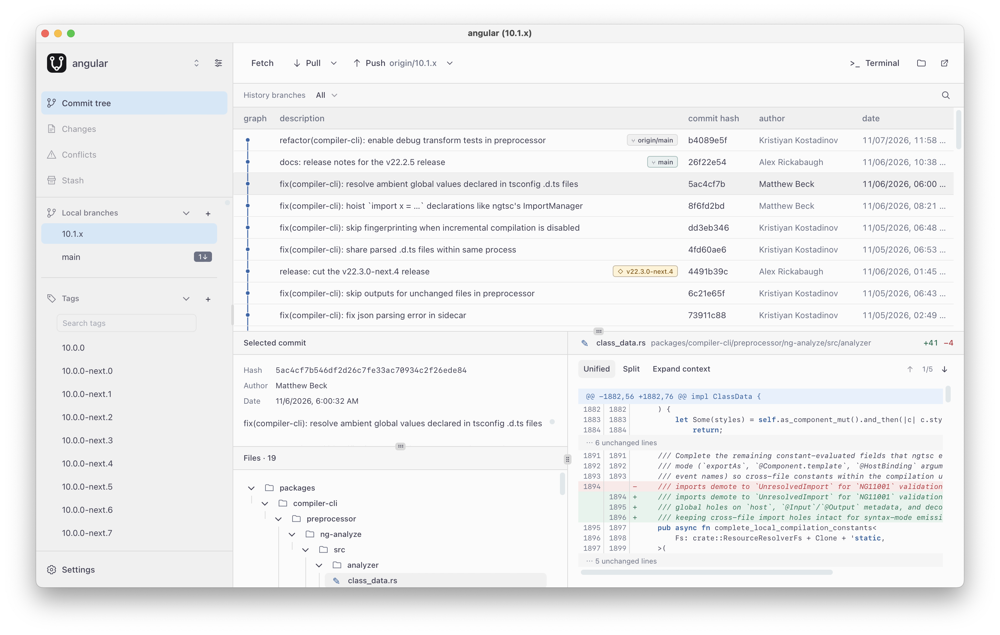

# GIT UI

GIT UI is a free desktop Git client for macOS and Windows. Browse commit history,
review changes, and work with branches, tags, and stashes in one window.

**[Download from GitHub Releases](https://github.com/ufocoder/git-ui/releases/latest)** ·
[User guide](docs/features.md)

## Built for everyday Git work

I built GIT UI for my own work and use it on my own repositories. It will always
be free to use. You can read the source in this repository, inspect the release
workflow, or build the app yourself.

- **Use your existing repositories.** Open a local folder and work with the Git
  installation, remotes, and authentication you already use. No GIT UI account
  is required.
- **Review before you commit.** Browse the commit graph, compare changes in
  unified or split view, and stage individual files or hunks.
- **See what Git did.** The built-in terminal log shows the output of Git
  operations, including errors.

## Get started

1. Install Git if it is missing from your system.
2. Download the installer for macOS (Apple Silicon or Intel) or Windows (x64).
3. Open GIT UI, choose a project, and select a local Git repository.

The interface is available in Russian, English, and Simplified Chinese. Change it
under Settings > Appearance > Interface language. On first launch GIT UI follows
a supported system language preference; your choice is saved for later runs.

[Development and setup](docs/development.md) ·
[Releases and updates](docs/releases.md) ·
[Landing page setup](docs/website.md)
